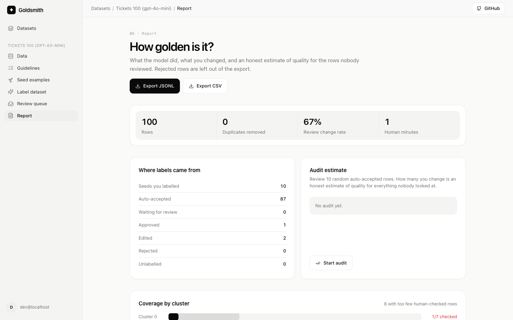

# Goldsmith

Human-in-the-loop builder for golden LLM eval datasets. Label 10 rows, review only the uncertain ones, get a measured "goldenness" report.

> Early development, built in public.



## How it works

1. **Upload** a CSV or JSONL file (classification, Q&A or chat). Near-duplicates are removed and similar rows are grouped into clusters.
2. **Write guidelines** and **label about 10 seed rows**, picked to cover every cluster.
3. **Label the dataset.** An LLM labels every row and scores how unsure it is (samples that disagree, rule concerns, rows unlike anything a human labelled, a mismatch with a label already in your file). For Q&A and chat, turn on **Best of 3** and a judge picks the strongest of the sampled answers; a low judge score sends the row to review.
4. **Review** only the rows above your threshold. Approve, reject, edit, press **Suggest fix** to have the model repair the problems it flagged, or give an instruction and apply it to similar rows. Every correction is reused as context for later labelling.
5. **Report and export.** See what changed, run a 10-row audit of auto-accepted rows for an honest quality estimate, and download JSONL or CSV (zipped with a `manifest.json`).

No data handy? Click **Try with sample data** on the home page to load 100 support tickets.

## Quickstart

Requirements: [uv](https://docs.astral.sh/uv/), Node 20+, PostgreSQL with the [pgvector](https://github.com/pgvector/pgvector) extension (for example `brew install postgresql@15 pgvector`).

```sh
make setup   # creates .env, databases, installs deps, runs migrations
# then set OPENAI_API_KEY in .env (OPENAI_MODEL is gpt-4o-mini by default)
make dev     # API on :8000, app on http://localhost:5173
make test
make lint
```

### Benchmark

Measure how well the review queue finds the model's mistakes on a file that already has human labels (classification only for now):

```sh
cd backend && uv run --env-file ../.env python -m goldsmith.bench my_labelled.csv --gold label --budget 20
```

The gold column is hidden from the model. The 10 seeds are labelled from it, and the rest of the file is labelled once. The script then compares three ways of spending the same review budget: Goldsmith's queue (most uncertain rows first), random review, and no review. It prints the accuracy of each as JSON. The run is saved as a project under a `bench@goldsmith.local` user.

### Google sign-in

Locally, `DEV_AUTH_BYPASS=true` signs you in as a fake dev user. For real Google sign-in, create an OAuth client (type "Web application") in Google Cloud Console, add `http://localhost:5173/api/auth/google/callback` as an authorised redirect URI, put the client ID and secret in `.env`, and set `DEV_AUTH_BYPASS=false`.

## Layout

- `backend/`: Python 3.12, FastAPI, SQLAlchemy, Alembic
- `frontend/`: React, Vite, TypeScript, Tailwind

## Credits

Goldsmith learns from these open-source projects: [DeepEval](https://github.com/confident-ai/deepeval), [distilabel](https://github.com/argilla-io/distilabel) and [Argilla](https://github.com/argilla-io/argilla), [Langfuse](https://github.com/langfuse/langfuse) and [Kiln](https://github.com/Kiln-AI/Kiln).

Two ideas come from papers, with no code copied: the benchmark's fixed task, fixed budget setup follows [FT-Dojo](https://arxiv.org/abs/2603.01712), and **Suggest fix** follows [AutoSFT](https://arxiv.org/abs/2610.22194) in repairing flagged rows instead of only dropping them.

### Code and prompts adapted from other projects

- The labelling prompt ([label_v1.md](backend/goldsmith/llm/prompts/label_v1.md)) adapts the section layout of distilabel's `TextClassification` task template (Apache-2.0, Copyright Argilla, Inc.). See [NOTICE](NOTICE).

- Icons in [Icon.tsx](frontend/src/components/Icon.tsx) are copied from [Lucide](https://lucide.dev) (ISC). See [NOTICE](NOTICE).
- The app's layout and review inbox take inspiration from [hitl.sh](https://hitl.sh). Branding and code are our own.

## Licence

Apache-2.0
